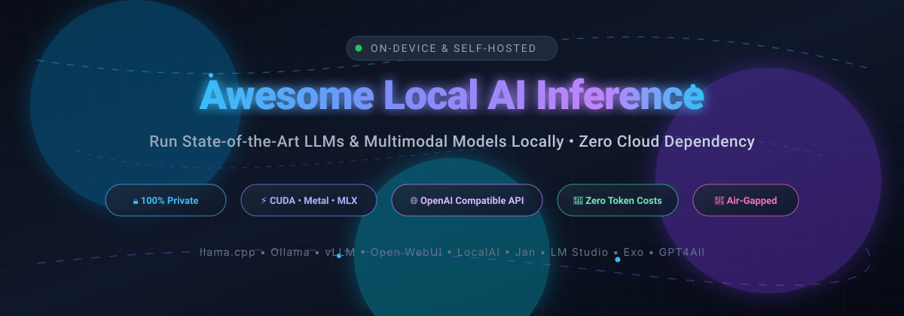

  

# 🚀 Awesome-Local-AI-Inference

## ⚡ Curated Guide to Local AI Inference: On-Device Execution, Self-Hosted Runtimes & Local LLM Servers

**A comprehensive, SEO-optimized directory of top SaaS platforms and open-source GitHub projects for local AI inference, on-device LLMs, offline AI, private machine learning, and self-hosted model runtimes.** 🧠✨

**Last updated: October 2026** 📅

---

This repository tracks notable **SaaS platforms** ☁️ and **open-source projects** 🛠️ for **Local AI Inference**. These tools empower developers, engineers, and privacy-conscious users to execute state-of-the-art large language models (LLMs), multimodal vision models, and embedding pipelines directly on consumer hardware—including Mac Apple Silicon (Metal/MLX), Windows/Linux workstations (NVIDIA CUDA / AMD ROCm / Intel oneAPI), and self-hosted home server clusters—without mandatory third-party cloud dependencies. 🖥️⚡

Running models locally guarantees absolute data privacy 🔒, zero-latency network independence ⚡, resilience against outages 🛡️, offline availability 📶, and predictable hardware costs without per-token API charges 💸.

---

## 📑 Table of Contents

- [📊 Sector Overview & Market Dynamics](#-sector-overview--market-dynamics)
- [☁️ SaaS & Hybrid Hosted Platforms](#️-saas--hybrid-hosted-platforms)
- [🛠️ Open-Source GitHub Projects](#️-open-source-github-projects)
- [🧩 Additional Recommended Frameworks](#-additional-recommended-frameworks)
- [⚖️ Comparison & Architecture Selection](#️-comparison--architecture-selection)
- [🤝 How to Contribute](#-how-to-contribute)
- [⭐ Star History](#-star-history)
- [💖 Support](#-support)
- [⚠️ Disclaimer](#️-disclaimer)

---

## 📊 Sector Overview & Market Dynamics

The global **AI inference market** is valued at approximately **$106B–$110B** in 2025–2026 and is projected to reach **$255B by 2030** (growing at ~19.2% CAGR), while the dedicated **edge and on-device AI inference** segment is valued at **$25B–$30B** and scaling rapidly beyond **$120B+** at over 25% CAGR. 📈

The sector is currently **moderately fragmented**: foundational execution engines (anchored by `llama.cpp` and `vLLM`) establish de-facto low-level infrastructure standards, yet the consumer and enterprise application layer remains intensely contested between turn-key desktop interfaces, distributed home clusters, local orchestration runtimes, and hybrid cloud-bursting offerings rather than a single winner-take-all monopoly. 🌐

---

## ☁️ SaaS & Hybrid Hosted Platforms

The following hosted/hybrid platforms provide consumer desktop and developer tools paired with cloud-bursting, remote inference, or team orchestration tiers.

| Product | Description | Scale & Valuation / Funding | Pricing | Free Tier Limit |
| :--- | :--- | :--- | :--- | :--- |
| **[Ollama Cloud](https://ollama.com/)** | Hosted tier and registry orchestration of the open-source Ollama runtime for models exceeding local consumer hardware limits. | **$88M raised** (Series B led by Theory Ventures; backed by Benchmark & Y Combinator) | **Free**: $0 starting tier. **Cloud Burst**: Pay-as-you-go per-token rates (no base subscription fee). | **Free plan**: Unlimited local model execution via Ollama runner; free cloud tier provides monthly starter credits for select starter models with 1 concurrent request slot (resets monthly). |
| **[LM Studio](https://lmstudio.ai/)** | Leading desktop GUI application for managing and running local LLMs via llama.cpp and MLX, featuring optional cloud model integration. | **$19.3M raised**; ~$1.8M ARR (backed by Conviction, Genius Ventures, Google, Dylan Field) | **Free**: $0/month for local personal use. **Bionic+**: $20/month for hosted open models. **Pro**: $100/month for 5x cloud limits and early releases. | **Free tier**: 100% free forever for unlimited local inference across all supported GGUF and MLX models with zero token or hardware constraints; cloud proxy disabled on free tier. |

---

## 🛠️ Open-Source GitHub Projects

Curated list of production-grade open-source inference engines, model runners, web user interfaces, and distributed home cluster runtimes—ranked strictly by **GitHub Stars_Count** (descending). ⭐

1. **[Ollama](https://github.com/ollama/ollama)**  🦙  
   **The developer standard for running local LLMs.** Provides one-command model pulling and execution (`ollama run gemma4`, `ollama run llama3.3`). Native integrations via `ollama launch` for developer IDEs like Claude Code, Codex, and VS Code. Built-in OpenAI-compatible REST API at `localhost:11434`. Best for developers seeking the quickest zero-config route to running models locally.

2. **[Open WebUI](https://github.com/open-webui/open-webui)**  🖥️  
   **The premier self-hosted, feature-rich web interface for local models.** Extensible, self-hosted UI for Ollama, vLLM, and OpenAI-compatible backends. Offers full Retrieval-Augmented Generation (RAG), voice call support, multi-user role management, Python execution sandbox, and customizable web search integration.

3. **[llama.cpp](https://github.com/ggml-org/llama.cpp)**  ⚡  
   **The foundational C/C++ local inference engine.** Powers most local LLM tools (Ollama, LM Studio, Jan, Text Generation WebUI) under the hood. Supports raw CPU vectorization, CUDA, Metal, Vulkan, SYCL, and extreme integer quantization (GGUF: 2-bit through 8-bit). Best for maximum execution efficiency, minimal dependencies, and edge device deployment.

4. **[vLLM](https://github.com/vllm-project/vllm)**  🚀  
   **High-throughput and memory-efficient LLM serving engine.** Pioneered PagedAttention for continuous batching and high-concurrency request handling. Supports distributed multi-GPU tensor parallelism and OpenAI-compatible server APIs. Ideal for self-hosting high-traffic local inference clusters and enterprise API endpoints.

5. **[GPT4All](https://github.com/nomic-ai/gpt4all)**  📂  
   **Privacy-first desktop GUI with local file intelligence (LocalDocs).** MIT licensed. Enables chatting with private documents using an embedded local vector database without data ever leaving the user's workstation. Best for non-technical users wanting private, air-gapped document Q&A.

6. **[LocalAI](https://github.com/mudler/LocalAI)**  🤖  
   **All-in-one OpenAI-compatible local AI server.** MIT licensed drop-in alternative for REST APIs covering text generation (llama.cpp, vLLM), image synthesis (Stable Diffusion), audio transcription (Whisper), text-to-speech, embeddings, and vision. Automates GPU backend hardware detection across NVIDIA, AMD, and Intel.

7. **[Exo](https://github.com/exo-explore/exo)**  🌐  
   **Distributed device-mesh cluster for running oversized LLMs.** Dynamically networks heterogenous personal hardware—connecting MacBooks, iPhones, iPads, Linux PCs, and Raspberry Pis over Wi-Fi/Ethernet into a unified memory cluster. Enables home users to run massive models exceeding any single machine's VRAM.

8. **[Text Generation WebUI](https://github.com/oobabooga/text-generation-webui)**  🧪  
   **The power-user's versatile inference laboratory.** Gradio interface supporting swappable backend loaders including llama.cpp, Transformers, ExLlamaV2/V3, AutoGPTQ, and AWQ. Features extensive plugin ecosystem for LoRA fine-tuning, speech synthesis, multimodal analysis, and prompt engineering.

9. **[Jan](https://github.com/janhq/jan)**  💻  
   **100% open-source, privacy-first desktop conversational client.** Apache 2.0 licensed alternative to proprietary desktop GUIs. Features an integrated model manager, local OpenAI-compatible HTTP server (`localhost:6767/v1`), and native support for LlamaCPP and MLX backends on Apple Silicon and PC.

10. **[Strata](https://github.com/Niko1221/Strata)**  🧩  
    **Specialized high-performance runner for large MoE models on consumer hardware.** Purpose-engineered automated installer and runtime optimized for running large Mixture-of-Experts architectures (such as Qwen3.8-Flash-Next) efficiently on standard 12–24 GB consumer GPUs paired with system RAM offloading.

11. **[llamafile](https://github.com/Mozilla-Ocho/llamafile)**  📦  
    **Single-file multi-platform runnable AI executable by Mozilla Ocho.** Combines llama.cpp and Cosmopolitan Libc to turn open-weight LLMs into standalone multi-OS binary executables that run directly without installation or virtualization on Linux, macOS, and Windows.

12. **[Candle](https://github.com/huggingface/candle)**  🦀  
    **Minimalist Rust machine learning framework for serverless and on-device inference.** Developed by Hugging Face, focused on zero-dependency lightweight deployments, WebAssembly (Wasm) in-browser execution, and native Rust backend development.

13. **[KoboldAI Client](https://github.com/KoboldAI/KoboldAI-Client)**  ✍️  
    **Community-driven browser frontend specialized for creative writing and storytelling.** Fully free and ad-free, offering deep context memory management, adventure gaming modes, and direct connectivity to KoboldCpp backends.

---

## 🧩 Additional Recommended Frameworks

- **[MLX](https://github.com/ml-explore/mlx)** 🍏 — Apple silicon-native framework for machine learning research and lightning-fast local LLM inference on unified memory Mac systems.
- **[Aphrodite Engine](https://github.com/PygmalionAI/aphrodite-engine)** 🔥 — High-throughput serving engine optimized for open creative writing models, sampling control, and multi-user hosting.
- **[Tabby](https://github.com/TabbyML/tabby)** 🐱 — Self-hosted AI coding assistant alternative to GitHub Copilot, running completely on local infrastructure.

---

## ⚖️ Comparison & Architecture Selection

| Use Case | Recommended Solution | Key Advantage |
| :--- | :--- | :--- |
| **Instant Developer CLI & Agent Integration** 💻 | `Ollama` | Standardized one-command CLI, automatic GPU detection, integrated tooling |
| **Full-Featured Team Web Workspace** 👥 | `Open WebUI` | Granular RAG, document chats, multi-user permissions, OpenAI API compatibility |
| **Foundational C/C++ Performance** ⚡ | `llama.cpp` | Broadest quantization (GGUF) support, minimal memory overhead, zero runtime baggage |
| **High-Concurrency Production API** 🏭 | `vLLM` | PagedAttention continuous batching for maximum token-per-second server throughput |
| **Air-Gapped Private Document Chat** 🔒 | `GPT4All` | Native LocalDocs vector indexing without network transmission |
| **Desktop Cross-Platform GUI** 🖥️ | `LM Studio` / `Jan` | Intuitive visual model exploration, hardware monitoring, and one-click downloads |
| **Multi-Device Cluster Meshing** 🌐 | `Exo` | Pools consumer Macs, iPhones, and GPUs into a collective VRAM inference pool |

---

## 🤝 How to Contribute

1. Fork this repository 🍴.
2. Add your suggested open-source project or verified SaaS platform to [README.md](README.md) following existing formatting guidelines.
3. Ensure open-source additions include valid GitHub Stars_Badges linking directly to their `/stargazers` page ⭐.
4. Keep descriptions concise, unbiased, and technically accurate 📝.
5. Submit a pull request with details about why the tool qualifies 🚀.

---

##  Star History

---

## 💖 Support

Thank you so much for exploring and supporting **Awesome-Local-AI-Inference**! 🌟

If you find this repository helpful:
- ⭐ **Star** this repository on GitHub
- 🍴 **Fork** and contribute new tools or updates
- 📢 **Share** it with fellow AI engineers, researchers, and self-hosting enthusiasts
- ☕ **Support continuous maintenance & buy a coffee**: [Sponsor Dashboard on GitHub Sponsors](https://github.com/sponsors/ishandutta2007)

Your support helps keep this ecosystem directory accurate, comprehensive, and up-to-date! 🙌

---

## ⚠️ Disclaimer

- This list is community-curated for informational and engineering purposes.
- Always check individual project repository licenses before commercial distribution or enterprise deployment.
- Local AI inference execution relies on local compute hardware; ensure adequate thermal management and power delivery when running quantization workloads.

---

**Star ⭐ this repository to stay updated with breakthroughs across the open local AI inference landscape!** 🚀
